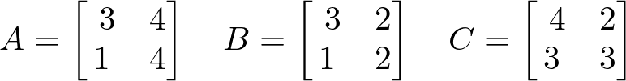
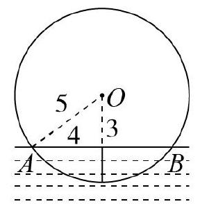

# AVP0604 — Single visual target

DynaMath:478 / MV-MATH:208_2 · different type · Numeric representation and conversion

## Shared or similar visual information

The numerical notation 3 in both images.

## Evidence locations

- Left image: The 3 in the top-left position of matrix A.
- Right image: The 3 beside the dashed vertical segment from O to chord AB.

## Mathematical meanings

Left image: Matrix A has entry 3 at row 1, column 1. Right image: The vertical segment from O to chord AB has length value 3.

## Same mathematical meanings

no

## Rationales

The left context gives the number the role of matrix entry, while the right context gives it the role of geometric length.

Only the selected target is annotated. AI visual-review draft; not independently double-annotated by humans.
