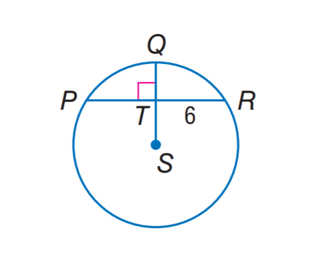
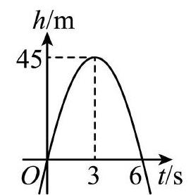

# AVP0606 — Single visual target

MathVista:990 / MV-MATH:624_1 · different type · Numeric representation and conversion

## Shared or similar visual information

The numerical notation 6 in both images.

## Evidence locations

- Left image: The 6 beside chord portion TR to the right of the vertical diameter.
- Right image: The 6 on the t/s axis beneath the curve's positive horizontal-axis crossing.

## Mathematical meanings

Left image: Segment TR has length value 6. Right image: The curve crosses back to zero height at time six seconds.

## Same mathematical meanings

no

## Rationales

The left context gives the number the role of geometric length, while the right context gives it the role of time in seconds.

Only the selected target is annotated. AI visual-review draft; not independently double-annotated by humans.
