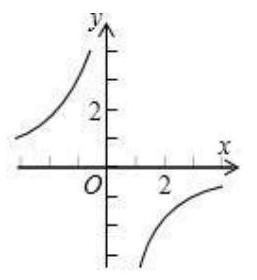
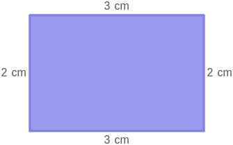

# AVP0607 — Single visual target

MV-MATH:955_1 / MathVista:606 · different type · Numeric representation and conversion

## Shared or similar visual information

The numerical notations 2 and 2 cm.

## Evidence locations

- Left image: The 2 under the positive labeled tick on the horizontal axis.
- Right image: The 2 cm beside the left side of the purple rectangle.

## Mathematical meanings

Left image: The tick marks x-coordinate 2. Right image: The indicated rectangle side measures two centimeters.

## Same mathematical meanings

no

## Rationales

The left context gives the number the role of horizontal coordinate, while the right context gives it the role of length with a specified unit.

Only the selected target is annotated. AI visual-review draft; not independently double-annotated by humans.
