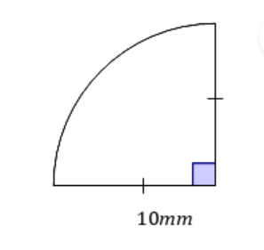
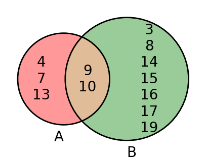

# AVP0608 — Single visual target

MathVerse:392 / DynaMath:473 · different type · Numeric representation and conversion

## Shared or similar visual information

The numerical notations 10 mm and 10.

## Evidence locations

- Left image: The 10mm beneath the horizontal radius in the quarter-circle diagram.
- Right image: The 10 in the overlapping region of the two sets.

## Mathematical meanings

Left image: The selected radius measures ten millimeters. Right image: The number 10 is a listed element of the intersection.

## Same mathematical meanings

no

## Rationales

The left context gives the number the role of length with a specified unit, while the right context gives it the role of listed set element.

Only the selected target is annotated. AI visual-review draft; not independently double-annotated by humans.
