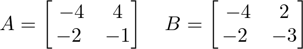

# AVP0609 — Single visual target

DynaMath:475 / MathVista:767 · different type · Numeric representation and conversion

## Shared or similar visual information

The numerical notation −4 in both images.

## Evidence locations

- Left image: The −4 in the top-left position of matrix A.
- Right image: The second component −4 in the blue point label (3,−4).

## Mathematical meanings

Left image: Matrix A has entry negative four at row 1, column 1. Right image: The blue point on the circle has y-coordinate negative four.

## Same mathematical meanings

no

## Rationales

The left context gives the number the role of matrix entry, while the right context gives it the role of vertical coordinate.

Only the selected target is annotated. AI visual-review draft; not independently double-annotated by humans.
