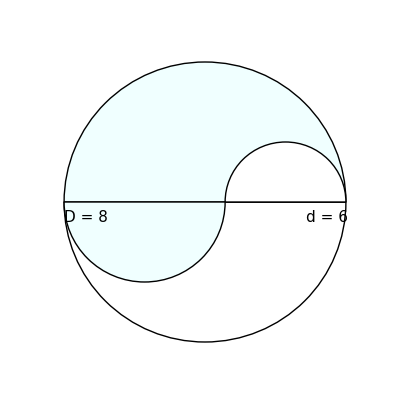
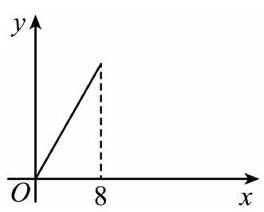

# AVP0610 — Single visual target

DynaMath:190 / MV-MATH:103_1 · different type · Numeric representation and conversion

## Shared or similar visual information

The numerical notation 8.

## Evidence locations

- Left image: The notation 8 appears at the left in D = 8.
- Right image: The notation 8 appears beneath the vertical dashed projection.

## Mathematical meanings

Left image: 8 is the diameter indicated by D. Right image: 8 is the horizontal coordinate of the line segment's upper endpoint.

## Same mathematical meanings

no

## Rationales

The notation on the left represents a diameter length. The notation on the right represents a horizontal coordinate.

Only the selected target is annotated. AI visual-review draft; not independently double-annotated by humans.
