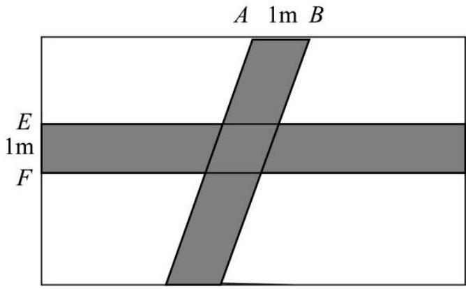
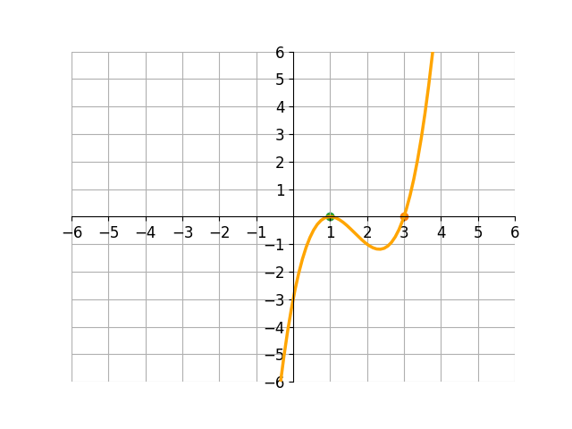

# AVP0611 — Single visual target

MV-MATH:916_1 / DynaMath:193 · different type · Numeric representation and conversion

## Shared or similar visual information

The numerical notations 1 m and 1.

## Evidence locations

- Left image: The 1 m between A and B along the rectangle's top edge.
- Right image: The 1 beneath the left-hand green point on the horizontal axis.

## Mathematical meanings

Left image: The sloping strip spans one meter along AB on the top boundary. Right image: The left-hand marked zero of the curve has x-coordinate 1.

## Same mathematical meanings

no

## Rationales

The left context gives the number the role of length with a specified unit, while the right context gives it the role of horizontal coordinate.

Only the selected target is annotated. AI visual-review draft; not independently double-annotated by humans.
