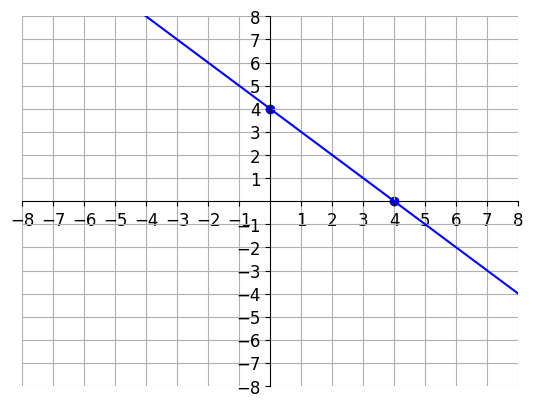
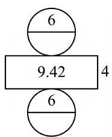

# AVP0612 — Single visual target

DynaMath:96 / MV-MATH:552_1 · different type · Numeric representation and conversion

## Shared or similar visual information

The numerical notation 4 in both images.

## Evidence locations

- Left image: The 4 beside the blue point where the line meets the vertical axis.
- Right image: The 4 to the right of the rectangle in the cylinder net.

## Mathematical meanings

Left image: The indicated vertical-axis intercept has y-coordinate 4. Right image: The rectangle's short side has length value 4.

## Same mathematical meanings

no

## Rationales

The left context gives the number the role of vertical coordinate, while the right context gives it the role of geometric length.

Only the selected target is annotated. AI visual-review draft; not independently double-annotated by humans.
