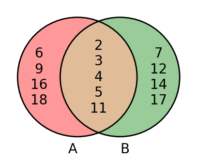
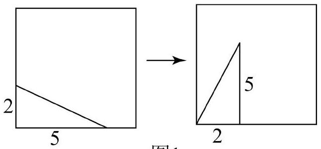

# AVP0614 — Single visual target

DynaMath:470 / MV-MATH:147_1 · different type · Numeric representation and conversion

## Shared or similar visual information

The numerical notation 2 in both images.

## Evidence locations

- Left image: The 2 at the top of the overlapping portion of the circles A and B.
- Right image: The 2 beside the short bottom segment of the right panel.

## Mathematical meanings

Left image: The number 2 is listed as an element of the intersection of the two sets. Right image: The bottom segment from the lower-left corner to the vertical segment has length value 2.

## Same mathematical meanings

no

## Rationales

The left context gives the number the role of listed set element, while the right context gives it the role of geometric length.

Only the selected target is annotated. AI visual-review draft; not independently double-annotated by humans.
