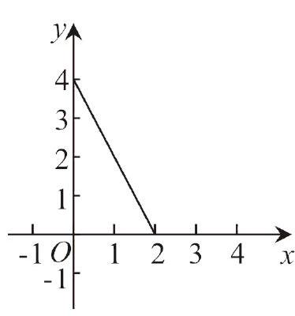
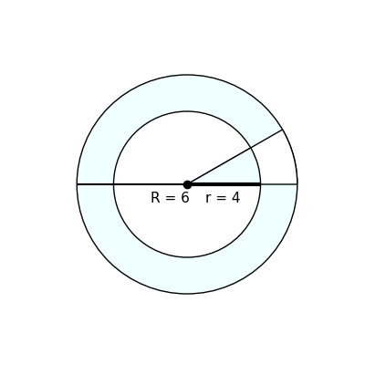

# AVP0615 — Single visual target

MV-MATH:1999_1 / DynaMath:113 · different type · Numeric representation and conversion

## Shared or similar visual information

The numerical notation 4 in both images.

## Evidence locations

- Left image: The 4 beside the top labeled vertical-axis tick where the line segment begins.
- Right image: The 4 in r = 4 near the center of the annulus.

## Mathematical meanings

Left image: The sloping segment meets the vertical axis at y-coordinate 4. Right image: The inner circle radius has length value 4.

## Same mathematical meanings

no

## Rationales

The left context gives the number the role of vertical coordinate, while the right context gives it the role of geometric length.

Only the selected target is annotated. AI visual-review draft; not independently double-annotated by humans.
