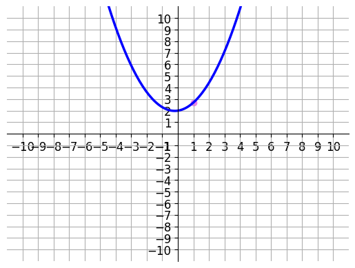
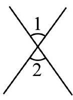

# AVP0616 — Single visual target

DynaMath:105 / MV-MATH:1012_1 · different type · Numeric representation and conversion

## Shared or similar visual information

The numerical notation 2 in both images.

## Evidence locations

- Left image: The 2 on the vertical axis where the blue parabola has its bottom point.
- Right image: The standalone 2 beneath the marked angle at the crossing of the diagonal lines.

## Mathematical meanings

Left image: The parabola's vertex has y-coordinate 2. Right image: The numeral 2 identifies the lower angle region.

## Same mathematical meanings

no

## Rationales

The left context gives the number the role of vertical coordinate, while the right context gives it the role of identifier of a marked angle.

Only the selected target is annotated. AI visual-review draft; not independently double-annotated by humans.
