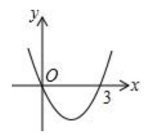
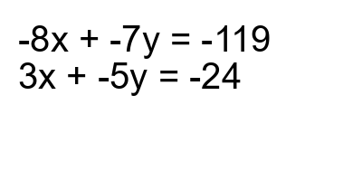

# AVP0617 — Single visual target

MV-MATH:969_1 / DynaMath:492 · different type · Numeric representation and conversion

## Shared or similar visual information

The numerical notation 3 in both images.

## Evidence locations

- Left image: The 3 beneath the positive horizontal-axis crossing of the parabola.
- Right image: The 3 before x at the beginning of the lower equation.

## Mathematical meanings

Left image: The positive intercept on the horizontal axis has x-coordinate 3. Right image: The coefficient of x in the lower equation is 3.

## Same mathematical meanings

no

## Rationales

The left context gives the number the role of horizontal coordinate, while the right context gives it the role of multiplicative coefficient.

Only the selected target is annotated. AI visual-review draft; not independently double-annotated by humans.
