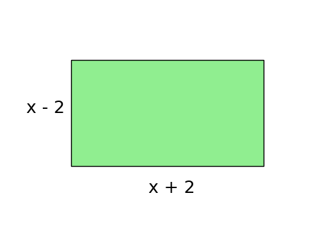
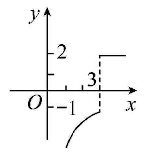

# AVP0618 — Single visual target

DynaMath:65 / MV-MATH:94_1 · different type · Numeric representation and conversion

## Shared or similar visual information

The numerical notation 2 in both images.

## Evidence locations

- Left image: The positive 2 added in x + 2 beneath the rectangle's bottom edge.
- Right image: The 2 beside the upper labeled tick on the vertical axis.

## Mathematical meanings

Left image: The 2 is an additive constant in the bottom edge's length expression. Right image: The tick marks y-coordinate 2.

## Same mathematical meanings

no

## Rationales

The left context gives the number the role of additive constant, while the right context gives it the role of vertical coordinate.

Only the selected target is annotated. AI visual-review draft; not independently double-annotated by humans.
