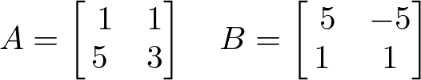
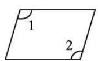

# AVP0620 — Single visual target

DynaMath:485 / MV-MATH:1027_1 · different type · Numeric representation and conversion

## Shared or similar visual information

The numerical notation 1 in both images.

## Evidence locations

- Left image: The 1 in the top-left position of matrix A.
- Right image: The standalone 1 just below the marked upper-left corner of the parallelogram.

## Mathematical meanings

Left image: Matrix A has entry 1 at row 1, column 1. Right image: The numeral 1 identifies the upper-left angle region.

## Same mathematical meanings

no

## Rationales

The left context gives the number the role of matrix entry, while the right context gives it the role of identifier of a marked angle.

Only the selected target is annotated. AI visual-review draft; not independently double-annotated by humans.
