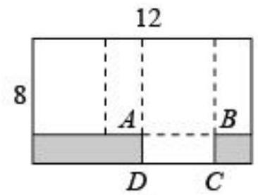
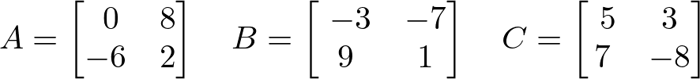

# AVP0621 — Single visual target

MV-MATH:10_3 / DynaMath:489 · different type · Numeric representation and conversion

## Shared or similar visual information

The numerical notation 8 in both images.

## Evidence locations

- Left image: The 8 outside the rectangle beside its left edge.
- Right image: The 8 in the top row and second column of matrix A.

## Mathematical meanings

Left image: The rectangle's left edge has length value 8. Right image: Matrix A has entry 8 at row 1, column 2.

## Same mathematical meanings

no

## Rationales

The left context gives the number the role of geometric length, while the right context gives it the role of matrix entry.

Only the selected target is annotated. AI visual-review draft; not independently double-annotated by humans.
