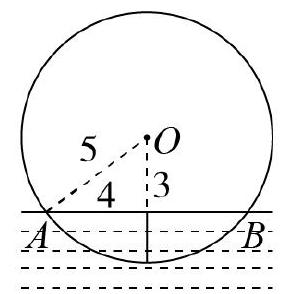
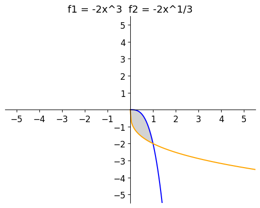

# AVP0623 — Single visual target

MV-MATH:208_2 / DynaMath:119 · different type · Numeric representation and conversion

## Shared or similar visual information

The numerical notation 3 in both images.

## Evidence locations

- Left image: The 3 beside the dashed vertical segment from O to chord AB.
- Right image: The 3 after the caret in the left formula f1 = −2x^3.

## Mathematical meanings

Left image: The vertical segment from O to chord AB has length value 3. Right image: The left formula raises x to the third power.

## Same mathematical meanings

no

## Rationales

The left context gives the number the role of geometric length, while the right context gives it the role of exponent.

Only the selected target is annotated. AI visual-review draft; not independently double-annotated by humans.
