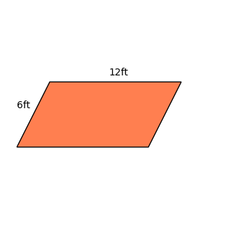
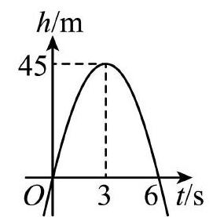

# AVP0624 — Single visual target

DynaMath:41 / MV-MATH:624_1 · different type · Numeric representation and conversion

## Shared or similar visual information

The numerical notations 6 ft and 6.

## Evidence locations

- Left image: The 6ft beside the left sloping side of the orange parallelogram.
- Right image: The 6 on the t/s axis beneath the curve's positive horizontal-axis crossing.

## Mathematical meanings

Left image: The left side measures six feet. Right image: The curve crosses back to zero height at time six seconds.

## Same mathematical meanings

no

## Rationales

The left context gives the number the role of length with a specified unit, while the right context gives it the role of time in seconds.

Only the selected target is annotated. AI visual-review draft; not independently double-annotated by humans.
