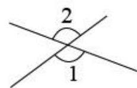
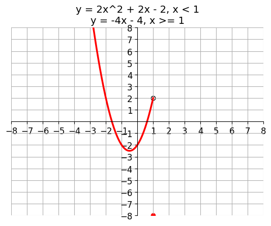

# AVP0625 — Single visual target

MV-MATH:500_1 / DynaMath:88 · different type · Numeric representation and conversion

## Shared or similar visual information

The numerical notation 2 in both images.

## Evidence locations

- Left image: The standalone 2 above the arc marking the upper angle at the crossing.
- Right image: The 2 immediately preceding x in the first term of 2x^2 + 2x − 2.

## Mathematical meanings

Left image: The numeral 2 identifies the upper angle region. Right image: The quadratic term has coefficient 2.

## Same mathematical meanings

no

## Rationales

The left context gives the number the role of identifier of a marked angle, while the right context gives it the role of multiplicative coefficient.

Only the selected target is annotated. AI visual-review draft; not independently double-annotated by humans.
