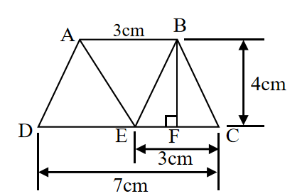
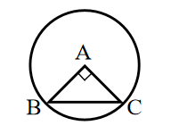

# AVP0626 — Single visual target

We-Math:1415 / We-Math:365 · same type · Geometric markers

## Shared or similar visual information

A small square placed where two segments meet.

## Evidence locations

- Left image: The small outlined square at F beside the vertical segment BF.
- Right image: The tilted square between AB and AC inside the circle.

## Mathematical meanings

Left image: BF is perpendicular to the horizontal base at F. Right image: AB and AC meet at a right angle at A.

## Same mathematical meanings

yes

## Rationales

The corner box lies inside the angle between the selected segments on each side. That placement marks a perpendicular intersection in both diagrams.

Only the selected target is annotated. AI visual-review draft; not independently double-annotated by humans.
