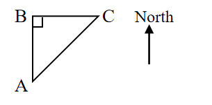
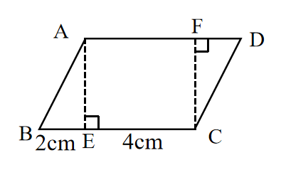

# AVP0627 — Single visual target

We-Math:1251 / We-Math:223 · same type · Geometric markers

## Shared or similar visual information

A small square placed where two segments meet.

## Evidence locations

- Left image: The square in the upper-left triangle corner labeled B.
- Right image: The square at E, where the left dashed vertical drops to the base.

## Mathematical meanings

Left image: BA and BC meet at a right angle at B. Right image: AE is perpendicular to BC at E.

## Same mathematical meanings

yes

## Rationales

The corner box lies inside the angle between the selected segments on each side. That placement marks a perpendicular intersection in both diagrams.

Only the selected target is annotated. AI visual-review draft; not independently double-annotated by humans.
