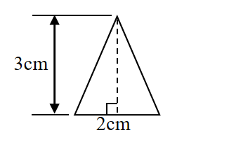
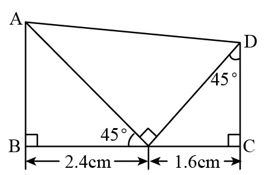

# AVP0628 — Single visual target

We-Math:1426 / We-Math:179 · same type · Geometric markers

## Shared or similar visual information

A small square placed where two segments meet.

## Evidence locations

- Left image: The square where the dashed altitude meets the triangle base.
- Right image: The tilted square between the two oblique segments where they meet the base.

## Mathematical meanings

Left image: The dashed altitude is perpendicular to the base. Right image: The two oblique segments meet at a right angle at their common base point.

## Same mathematical meanings

yes

## Rationales

The corner box lies inside the angle between the selected segments on each side. That placement marks a perpendicular intersection in both diagrams.

Only the selected target is annotated. AI visual-review draft; not independently double-annotated by humans.
