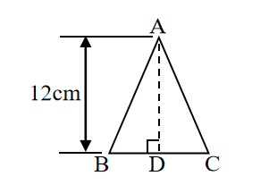
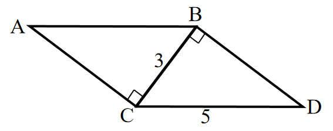

# AVP0629 — Single visual target

We-Math:1097 / We-Math:224 · same type · Geometric markers

## Shared or similar visual information

A small square placed where two segments meet.

## Evidence locations

- Left image: The small square at D, under the dashed segment AD.
- Right image: The tilted square at C between AC and CB.

## Mathematical meanings

Left image: AD is perpendicular to BC at D. Right image: AC is perpendicular to CB at C.

## Same mathematical meanings

yes

## Rationales

The corner box lies inside the angle between the selected segments on each side. That placement marks a perpendicular intersection in both diagrams.

Only the selected target is annotated. AI visual-review draft; not independently double-annotated by humans.
