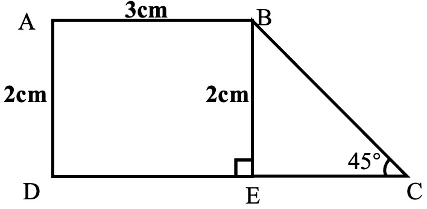
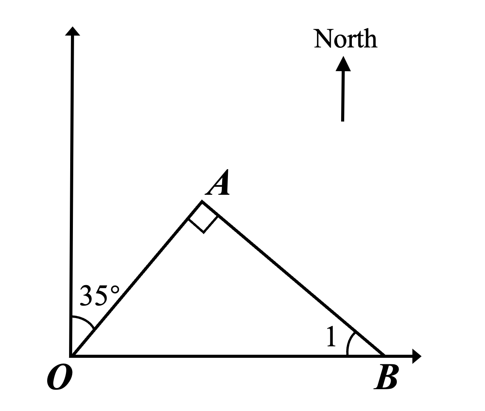

# AVP0630 — Single visual target

We-Math:1271 / We-Math:229 · same type · Geometric markers

## Shared or similar visual information

A small square placed where two segments meet.

## Evidence locations

- Left image: The square at E beside the vertical segment BE.
- Right image: The tilted square at A, between OA and AB.

## Mathematical meanings

Left image: BE is perpendicular to DC at E. Right image: OA is perpendicular to AB at A.

## Same mathematical meanings

yes

## Rationales

The corner box lies inside the angle between the selected segments on each side. That placement marks a perpendicular intersection in both diagrams.

Only the selected target is annotated. AI visual-review draft; not independently double-annotated by humans.
