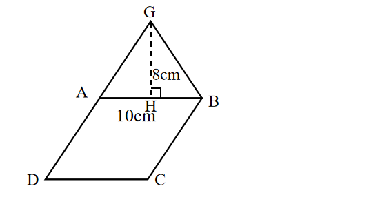
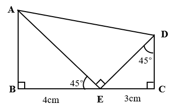

# AVP0631 — Single visual target

We-Math:1447 / We-Math:1181 · same type · Geometric markers

## Shared or similar visual information

A small square placed where two segments meet.

## Evidence locations

- Left image: The square at H, where the dashed segment GH meets AB.
- Right image: The tilted square at E between EA and ED.

## Mathematical meanings

Left image: GH is perpendicular to AB at H. Right image: EA and ED meet at a right angle at E.

## Same mathematical meanings

yes

## Rationales

The corner box lies inside the angle between the selected segments on each side. That placement marks a perpendicular intersection in both diagrams.

Only the selected target is annotated. AI visual-review draft; not independently double-annotated by humans.
