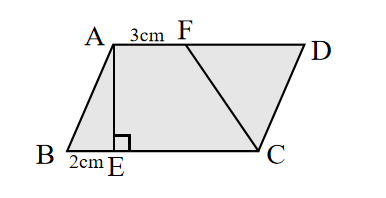
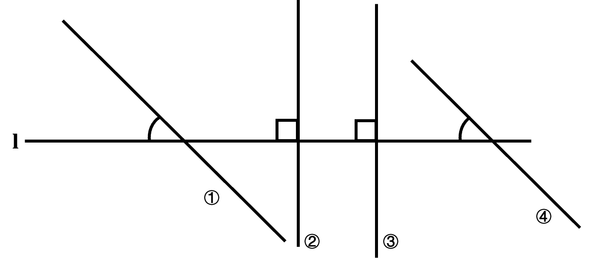

# AVP0632 — Single visual target

We-Math:1125 / We-Math:703 · same type · Geometric markers

## Shared or similar visual information

A small square placed where two segments meet.

## Evidence locations

- Left image: The square at E at the foot of AE.
- Right image: The square at the intersection of the horizontal line with the left of the two vertical lines.

## Mathematical meanings

Left image: AE is perpendicular to BC at E. Right image: That vertical line is perpendicular to the horizontal reference line.

## Same mathematical meanings

yes

## Rationales

The corner box lies inside the angle between the selected segments on each side. That placement marks a perpendicular intersection in both diagrams.

Only the selected target is annotated. AI visual-review draft; not independently double-annotated by humans.
