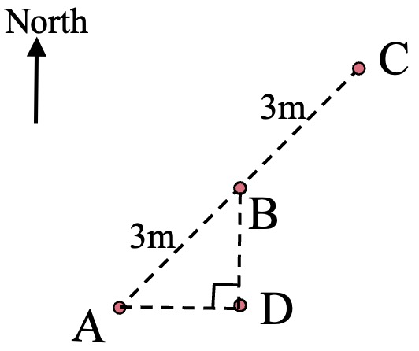
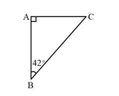

# AVP0633 — Single visual target

We-Math:1403 / We-Math:1304 · same type · Geometric markers

## Shared or similar visual information

A small square placed where two segments meet.

## Evidence locations

- Left image: The small right-angle box at D, between the horizontal and vertical dashed segments.
- Right image: The small square at A above the vertical side AB.

## Mathematical meanings

Left image: AD is perpendicular to BD at D. Right image: AB and AC meet at a right angle at A.

## Same mathematical meanings

yes

## Rationales

The corner box lies inside the angle between the selected segments on each side. That placement marks a perpendicular intersection in both diagrams.

Only the selected target is annotated. AI visual-review draft; not independently double-annotated by humans.
