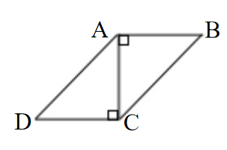
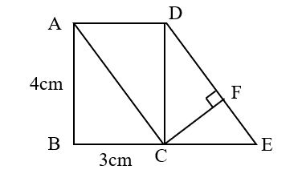

# AVP0634 — Single visual target

We-Math:178 / We-Math:1217 · same type · Geometric markers

## Shared or similar visual information

A small square placed where two segments meet.

## Evidence locations

- Left image: The square just below AB and to the right of AC at A.
- Right image: The rotated square at F, between CF and the sloping side DE.

## Mathematical meanings

Left image: AB is perpendicular to AC at A. Right image: CF is perpendicular to DE at F.

## Same mathematical meanings

yes

## Rationales

The corner box lies inside the angle between the selected segments on each side. That placement marks a perpendicular intersection in both diagrams.

Only the selected target is annotated. AI visual-review draft; not independently double-annotated by humans.
