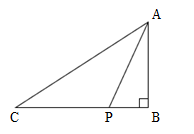
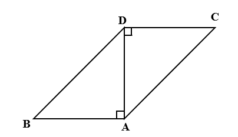

# AVP0635 — Single visual target

We-Math:180 / We-Math:1345 · same type · Geometric markers

## Shared or similar visual information

A small square placed where two segments meet.

## Evidence locations

- Left image: The square at B on the lower-right corner of the triangle.
- Right image: The square at A between the bottom horizontal side and the vertical diagonal AD.

## Mathematical meanings

Left image: BA is perpendicular to BC at B. Right image: AD is perpendicular to AB at A.

## Same mathematical meanings

yes

## Rationales

The corner box lies inside the angle between the selected segments on each side. That placement marks a perpendicular intersection in both diagrams.

Only the selected target is annotated. AI visual-review draft; not independently double-annotated by humans.
