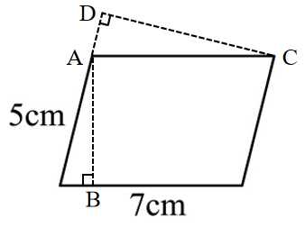
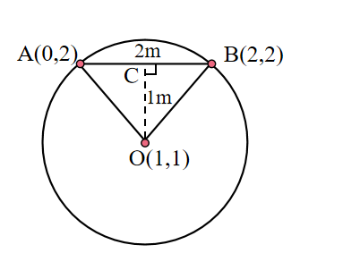

# AVP0636 — Single visual target

We-Math:185 / We-Math:1400 · same type · Geometric markers

## Shared or similar visual information

A small square placed where two segments meet.

## Evidence locations

- Left image: The tilted square at D on the dashed line through A.
- Right image: The square at C, at the upper end of the dashed segment from O.

## Mathematical meanings

Left image: DC is perpendicular to the line through D and A. Right image: CO is perpendicular to chord AB at C.

## Same mathematical meanings

yes

## Rationales

The corner box lies inside the angle between the selected segments on each side. That placement marks a perpendicular intersection in both diagrams.

Only the selected target is annotated. AI visual-review draft; not independently double-annotated by humans.
