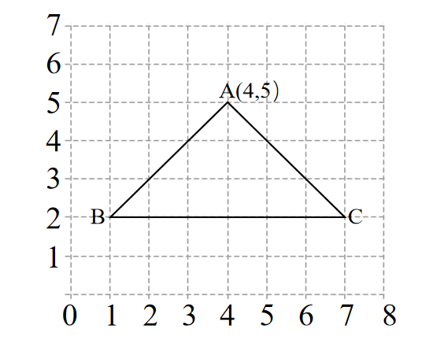
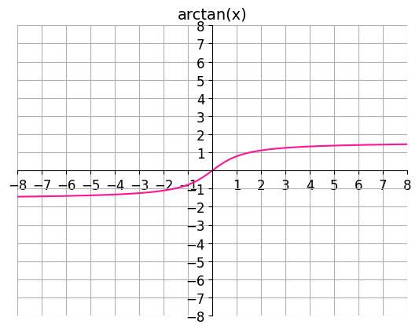

# AVP0637 — Single visual target

We-Math:1295 / DynaMath:118 · different type · Geometric markers

## Shared or similar visual information

A small square cell inside a regular coordinate grid.

## Evidence locations

- Left image: A complete pale square in the lattice beneath triangle ABC.
- Right image: The square grid cell above and immediately to the right of the axes intersection.

## Mathematical meanings

Left image: It is a grid cell that gives coordinate positions a common spatial scale. Right image: It is a coordinate-grid cell used to locate the arctangent trace.

## Same mathematical meanings

yes

## Rationales

The selected square is one cell of the repeated grid on each side. Its edges align with neighboring grid lines and support reading or comparing coordinates.

Only the selected target is annotated. AI visual-review draft; not independently double-annotated by humans.
