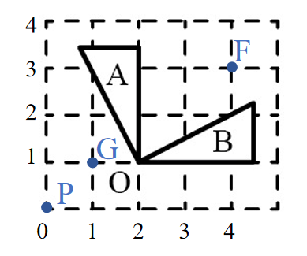
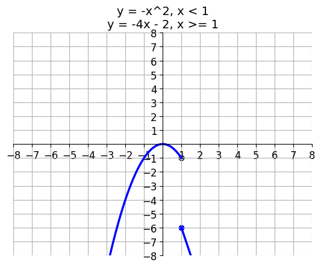

# AVP0638 — Single visual target

We-Math:397 / DynaMath:86 · different type · Geometric markers

## Shared or similar visual information

A small square cell inside a regular coordinate grid.

## Evidence locations

- Left image: A dashed square lattice cell in the lower-left portion of the grid.
- Right image: The pale square grid cell immediately above and to the right of the origin.

## Mathematical meanings

Left image: It is one cell of the coordinate grid used to position the rotated figures. Right image: It is a coordinate-grid cell used to read locations on the piecewise graph.

## Same mathematical meanings

yes

## Rationales

The selected square is one cell of the repeated grid on each side. Its edges align with neighboring grid lines and support reading or comparing coordinates.

Only the selected target is annotated. AI visual-review draft; not independently double-annotated by humans.
