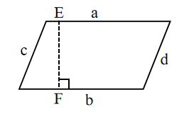
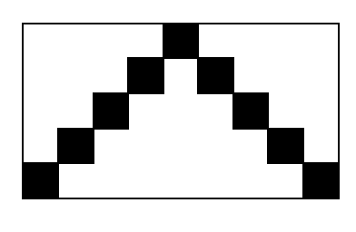

# AVP0639 — Single visual target

We-Math:497 / We-Math:1178 · same type · Geometric markers

## Shared or similar visual information

A square or nearly square shape with straight edges.

## Evidence locations

- Left image: The square at F, at the foot of the dashed segment EF.
- Right image: The small filled square at the top of the stepped black pattern.

## Mathematical meanings

Left image: EF is perpendicular to the bottom side of the parallelogram. Right image: It is one tile of the black geometric pattern.

## Same mathematical meanings

no

## Rationales

The square at the left intersection encodes a 90-degree angle between the selected lines. The right outline belongs to the object or spatial framework. It is one tile of the black geometric pattern.

Only the selected target is annotated. AI visual-review draft; not independently double-annotated by humans.
