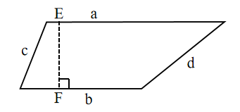
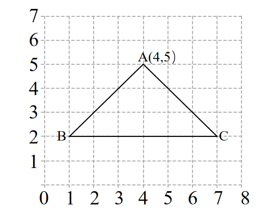

# AVP0640 — Single visual target

We-Math:498 / We-Math:1295 · same type · Geometric markers

## Shared or similar visual information

A square or nearly square shape with straight edges.

## Evidence locations

- Left image: The square at F, at the foot of the dashed segment from E.
- Right image: A complete pale square in the lattice beneath triangle ABC.

## Mathematical meanings

Left image: EF is perpendicular to the bottom side of the trapezoid. Right image: It is a grid cell that gives coordinate positions a common spatial scale.

## Same mathematical meanings

no

## Rationales

The square at the left intersection encodes a 90-degree angle between the selected lines. The right outline belongs to the object or spatial framework. It is a grid cell that gives coordinate positions a common spatial scale.

Only the selected target is annotated. AI visual-review draft; not independently double-annotated by humans.
