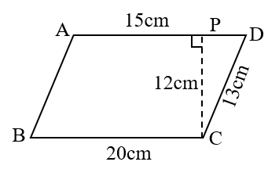
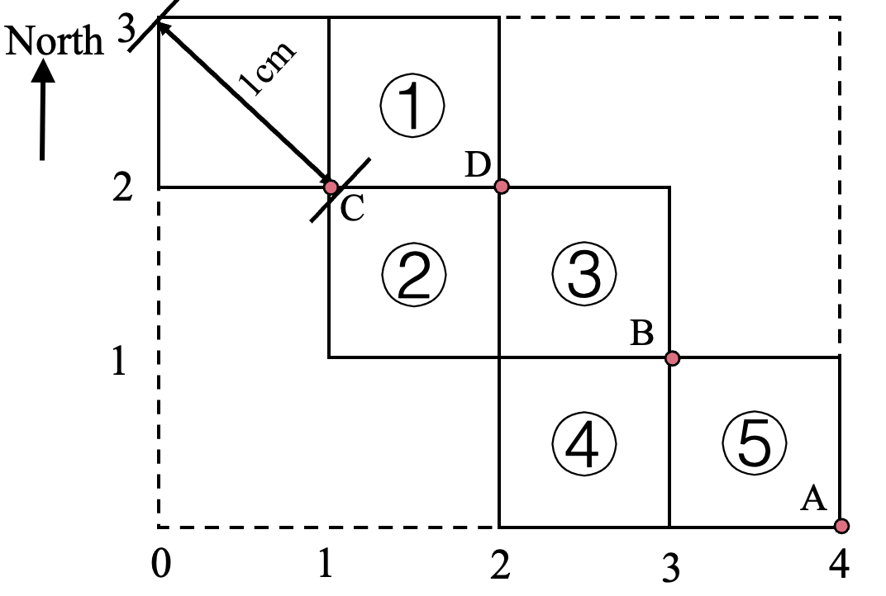

# AVP0641 — Single visual target

We-Math:1532 / We-Math:1374 · same type · Geometric markers

## Shared or similar visual information

A square or nearly square shape with straight edges.

## Evidence locations

- Left image: The square at P between the horizontal top side and dashed PC.
- Right image: The outlined square containing the circled 1 near the upper-left of the diagram.

## Mathematical meanings

Left image: PC is perpendicular to AD at P. Right image: It is a square component of the numbered planar arrangement.

## Same mathematical meanings

no

## Rationales

The square at the left intersection encodes a 90-degree angle between the selected lines. The right outline belongs to the object or spatial framework. It is a square component of the numbered planar arrangement.

Only the selected target is annotated. AI visual-review draft; not independently double-annotated by humans.
