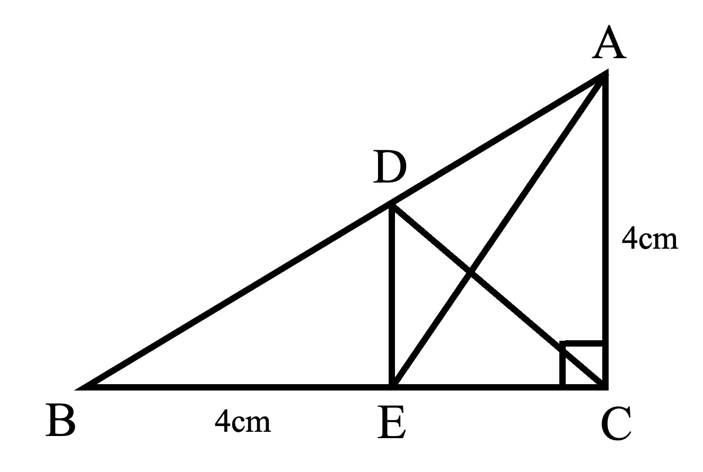
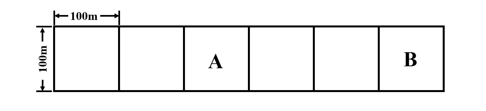

# AVP0642 — Single visual target

We-Math:1535 / We-Math:373 · same type · Geometric markers

## Shared or similar visual information

A square or nearly square shape with straight edges.

## Evidence locations

- Left image: The square at C in the lower-right corner of the outer triangle.
- Right image: The square labeled A in the row of six equal boxes.

## Mathematical meanings

Left image: CA is perpendicular to CB at C. Right image: It is one square component of the strip.

## Same mathematical meanings

no

## Rationales

The square at the left intersection encodes a 90-degree angle between the selected lines. The right outline belongs to the object or spatial framework. It is one square component of the strip.

Only the selected target is annotated. AI visual-review draft; not independently double-annotated by humans.
