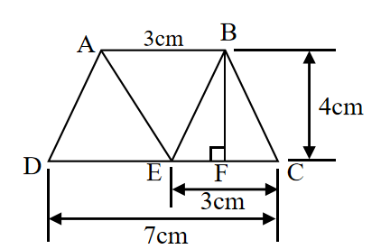
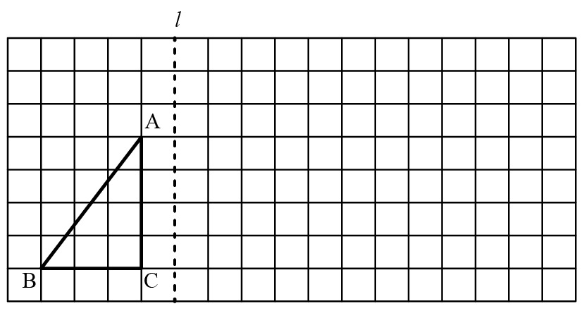

# AVP0643 — Single visual target

We-Math:1415 / We-Math:392 · same type · Geometric markers

## Shared or similar visual information

A square or nearly square shape with straight edges.

## Evidence locations

- Left image: The small outlined square at F beside the vertical segment BF.
- Right image: An empty square cell immediately to the right of the dashed vertical line.

## Mathematical meanings

Left image: BF is perpendicular to the horizontal base at F. Right image: It is a spatial cell in the lattice used to lay out the reflection construction.

## Same mathematical meanings

no

## Rationales

The square at the left intersection encodes a 90-degree angle between the selected lines. The right outline belongs to the object or spatial framework. It is a spatial cell in the lattice used to lay out the reflection construction.

Only the selected target is annotated. AI visual-review draft; not independently double-annotated by humans.
