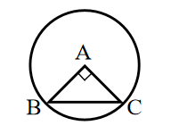
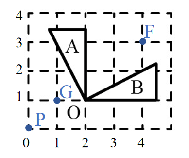

# AVP0644 — Single visual target

We-Math:365 / We-Math:397 · same type · Geometric markers

## Shared or similar visual information

A square or nearly square shape with straight edges.

## Evidence locations

- Left image: The tilted square between AB and AC inside the circle.
- Right image: A dashed square lattice cell in the lower-left portion of the grid.

## Mathematical meanings

Left image: AB and AC meet at a right angle at A. Right image: It is one cell of the coordinate grid used to position the rotated figures.

## Same mathematical meanings

no

## Rationales

The square at the left intersection encodes a 90-degree angle between the selected lines. The right outline belongs to the object or spatial framework. It is one cell of the coordinate grid used to position the rotated figures.

Only the selected target is annotated. AI visual-review draft; not independently double-annotated by humans.
