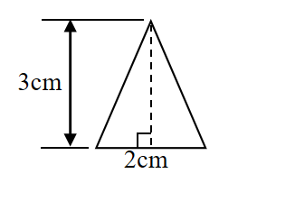
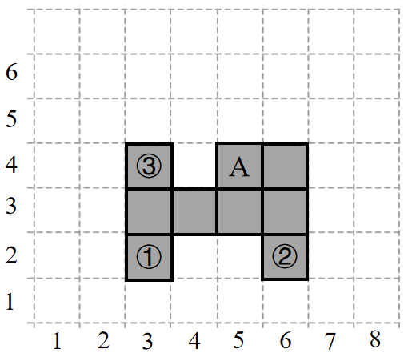

# AVP0645 — Single visual target

We-Math:1426 / We-Math:112 · same type · Geometric markers

## Shared or similar visual information

A square or nearly square shape with straight edges.

## Evidence locations

- Left image: The square where the dashed altitude meets the triangle base.
- Right image: The filled square labeled A in the tiled shape.

## Mathematical meanings

Left image: The dashed altitude is perpendicular to the base. Right image: It is one square tile in the gray figure.

## Same mathematical meanings

no

## Rationales

The square at the left intersection encodes a 90-degree angle between the selected lines. The right outline belongs to the object or spatial framework. It is one square tile in the gray figure.

Only the selected target is annotated. AI visual-review draft; not independently double-annotated by humans.
