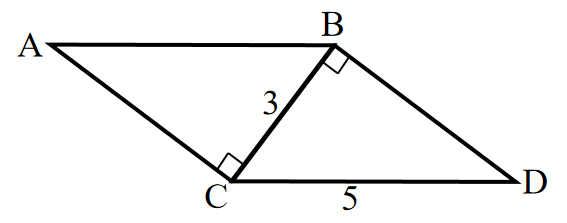
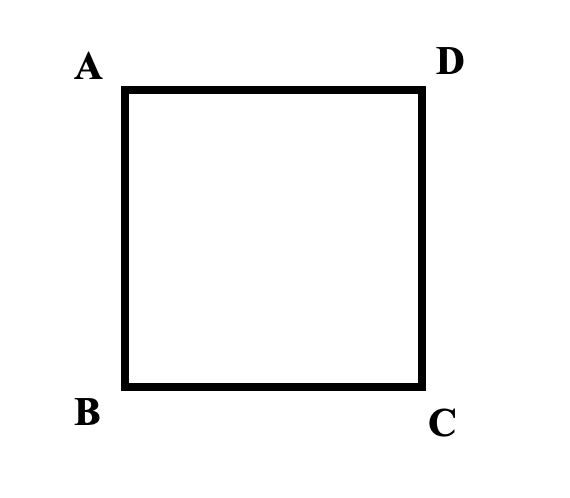

# AVP0646 — Single visual target

We-Math:224 / We-Math:995 · same type · Geometric markers

## Shared or similar visual information

A square or nearly square shape with straight edges.

## Evidence locations

- Left image: The tilted square at C between AC and CB.
- Right image: The large outlined square with vertices A, B, C and D.

## Mathematical meanings

Left image: AC is perpendicular to CB at C. Right image: It is the boundary of the square figure ABCD.

## Same mathematical meanings

no

## Rationales

The square at the left intersection encodes a 90-degree angle between the selected lines. The right outline belongs to the object or spatial framework. It is the boundary of the square figure ABCD.

Only the selected target is annotated. AI visual-review draft; not independently double-annotated by humans.
