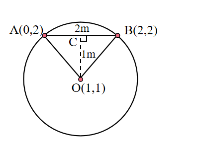
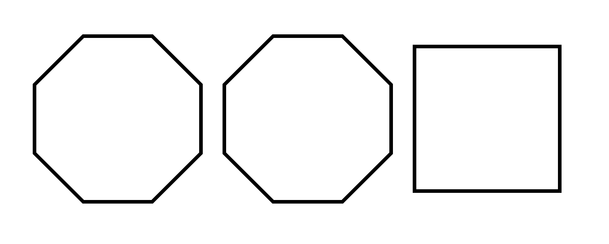

# AVP0647 — Single visual target

We-Math:1400 / We-Math:244 · same type · Geometric markers

## Shared or similar visual information

A square or nearly square shape with straight edges.

## Evidence locations

- Left image: The square at C, at the upper end of the dashed segment from O.
- Right image: The square outline on the right of the row of three polygons.

## Mathematical meanings

Left image: CO is perpendicular to chord AB at C. Right image: It is the boundary of the third polygon in the row.

## Same mathematical meanings

no

## Rationales

The square at the left intersection encodes a 90-degree angle between the selected lines. The right outline belongs to the object or spatial framework. It is the boundary of the third polygon in the row.

Only the selected target is annotated. AI visual-review draft; not independently double-annotated by humans.
