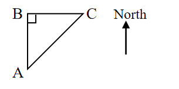
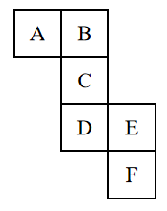

# AVP0648 — Single visual target

We-Math:1251 / We-Math:371 · different type · Geometric markers

## Shared or similar visual information

A square or nearly square shape with straight edges.

## Evidence locations

- Left image: The square in the upper-left triangle corner labeled B.
- Right image: The outlined square labeled A at the upper-left of the net.

## Mathematical meanings

Left image: BA and BC meet at a right angle at B. Right image: It is a square face in the unfolded cube net.

## Same mathematical meanings

no

## Rationales

The square at the left intersection encodes a 90-degree angle between the selected lines. The right outline belongs to the object or spatial framework. It is a square face in the unfolded cube net.

Only the selected target is annotated. AI visual-review draft; not independently double-annotated by humans.
