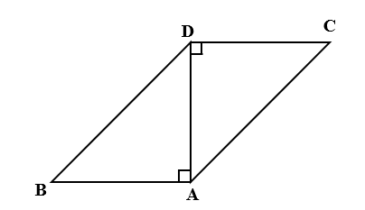
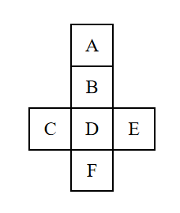

# AVP0649 — Single visual target

We-Math:1345 / We-Math:379 · different type · Geometric markers

## Shared or similar visual information

A square or nearly square shape with straight edges.

## Evidence locations

- Left image: The square at A between the bottom horizontal side and the vertical diagonal AD.
- Right image: The outlined square labeled D at the center of the cube net.

## Mathematical meanings

Left image: AD is perpendicular to AB at A. Right image: It is a square face in the unfolded cube net.

## Same mathematical meanings

no

## Rationales

The square at the left intersection encodes a 90-degree angle between the selected lines. The right outline belongs to the object or spatial framework. It is a square face in the unfolded cube net.

Only the selected target is annotated. AI visual-review draft; not independently double-annotated by humans.
