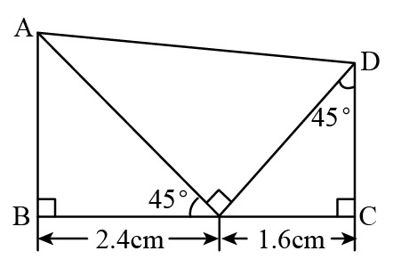
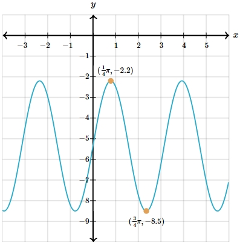

# AVP0650 — Single visual target

We-Math:179 / MathVerse:530 · different type · Geometric markers

## Shared or similar visual information

A square or nearly square shape with straight edges.

## Evidence locations

- Left image: The tilted square between the two oblique segments where they meet the base.
- Right image: The light-gray grid cell just to the right of the y-axis and below the x-axis.

## Mathematical meanings

Left image: The two oblique segments meet at a right angle at their common base point. Right image: It is a cell of the coordinate grid used to read locations on the wave plot.

## Same mathematical meanings

no

## Rationales

The square at the left intersection encodes a 90-degree angle between the selected lines. The right outline belongs to the object or spatial framework. It is a cell of the coordinate grid used to read locations on the wave plot.

Only the selected target is annotated. AI visual-review draft; not independently double-annotated by humans.
