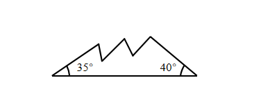
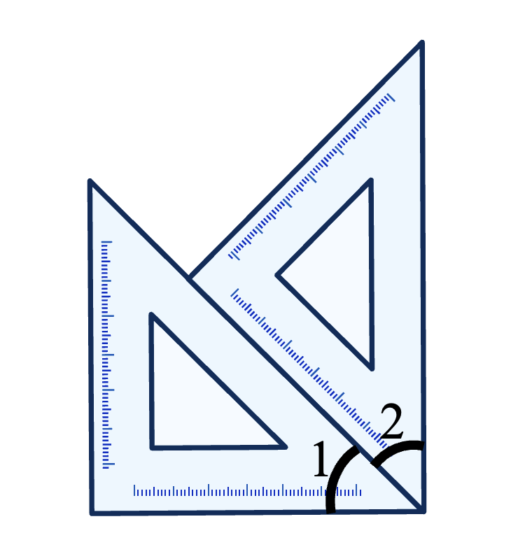

# AVP0651 — Single visual target

We-Math:1300 / We-Math:1170 · same type · Geometric markers

## Shared or similar visual information

A short circular arc drawn between rays near their common vertex.

## Evidence locations

- Left image: The small arc beside the 35-degree label at the left end of the jagged figure.
- Right image: The arc beside the numeral 2 near the lower-right corner of the superimposed rulers.

## Mathematical meanings

Left image: It identifies the vertex angle assigned the 35-degree measure. Right image: It identifies the wedge labeled angle 2 at the ruler intersection.

## Same mathematical meanings

yes

## Rationales

Each short arc is placed inside the wedge it selects. This use attaches an angle label to the relevant rays or identifies the marked vertex angle.

Only the selected target is annotated. AI visual-review draft; not independently double-annotated by humans.
