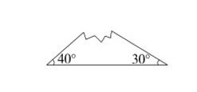
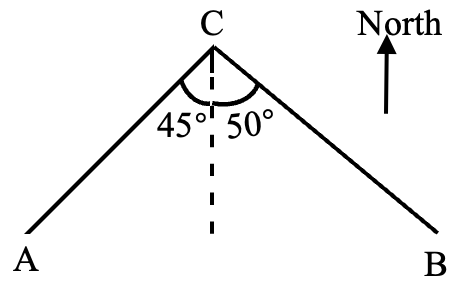

# AVP0652 — Single visual target

We-Math:1301 / We-Math:1574 · same type · Geometric markers

## Shared or similar visual information

A short circular arc drawn between rays near their common vertex.

## Evidence locations

- Left image: The arc next to the 30-degree label at the right base vertex.
- Right image: The arc on the left of the dashed reference at C, beside the 45-degree label.

## Mathematical meanings

Left image: It identifies the vertex angle assigned the 30-degree measure. Right image: It identifies the angle between CA and the dashed reference ray at C.

## Same mathematical meanings

yes

## Rationales

Each short arc is placed inside the wedge it selects. This use attaches an angle label to the relevant rays or identifies the marked vertex angle.

Only the selected target is annotated. AI visual-review draft; not independently double-annotated by humans.
