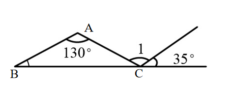
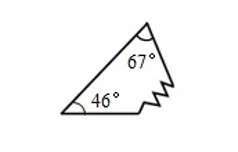

# AVP0653 — Single visual target

We-Math:1303 / We-Math:1308 · same type · Geometric markers

## Shared or similar visual information

A short circular arc drawn between rays near their common vertex.

## Evidence locations

- Left image: The arc beside the 130-degree label below vertex A.
- Right image: The small arc next to the 67-degree label at the top.

## Mathematical meanings

Left image: It identifies the angle at A assigned the 130-degree measure. Right image: It identifies the angle at the top vertex assigned the 67-degree measure.

## Same mathematical meanings

yes

## Rationales

Each short arc is placed inside the wedge it selects. This use attaches an angle label to the relevant rays or identifies the marked vertex angle.

Only the selected target is annotated. AI visual-review draft; not independently double-annotated by humans.
