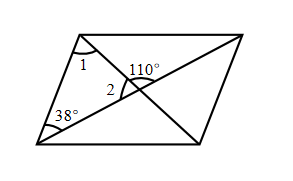
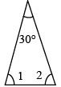

# AVP0654 — Single visual target

We-Math:1305 / We-Math:174 · same type · Geometric markers

## Shared or similar visual information

A short circular arc drawn between rays near their common vertex.

## Evidence locations

- Left image: The arc beside the 110-degree label where the two diagonals cross.
- Right image: The small arc next to the 30-degree label at the narrow top vertex.

## Mathematical meanings

Left image: It identifies the angle at the crossing assigned the 110-degree measure. Right image: It identifies the apex angle with measure 30 degrees.

## Same mathematical meanings

yes

## Rationales

Each short arc is placed inside the wedge it selects. This use attaches an angle label to the relevant rays or identifies the marked vertex angle.

Only the selected target is annotated. AI visual-review draft; not independently double-annotated by humans.
