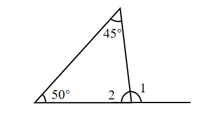
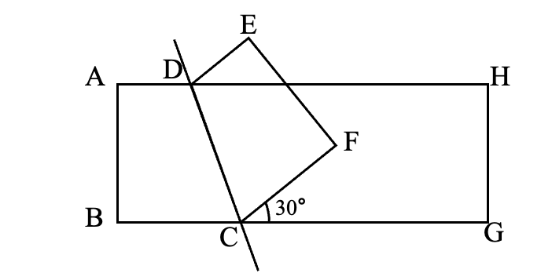

# AVP0655 — Single visual target

We-Math:1306 / We-Math:1364 · same type · Geometric markers

## Shared or similar visual information

A short circular arc drawn between rays near their common vertex.

## Evidence locations

- Left image: The arc at the top vertex beside the 45-degree label.
- Right image: The small arc beside the 30-degree label where the folded polygon meets the lower side at C.

## Mathematical meanings

Left image: It identifies the apex angle with measure 45 degrees. Right image: It identifies the 30-degree angle between CF and the rightward base ray.

## Same mathematical meanings

yes

## Rationales

Each short arc is placed inside the wedge it selects. This use attaches an angle label to the relevant rays or identifies the marked vertex angle.

Only the selected target is annotated. AI visual-review draft; not independently double-annotated by humans.
