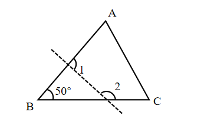
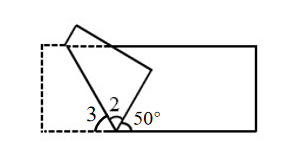

# AVP0656 — Single visual target

We-Math:1307 / We-Math:1477 · same type · Geometric markers

## Shared or similar visual information

A short circular arc drawn between rays near their common vertex.

## Evidence locations

- Left image: The small arc at B beside the 50-degree label.
- Right image: The small arc beside the 50-degree label along the base of the rectangle.

## Mathematical meanings

Left image: It identifies the angle at B assigned the 50-degree measure. Right image: It identifies the 50-degree angle between the sloping side and the rightward base ray.

## Same mathematical meanings

yes

## Rationales

Each short arc is placed inside the wedge it selects. This use attaches an angle label to the relevant rays or identifies the marked vertex angle.

Only the selected target is annotated. AI visual-review draft; not independently double-annotated by humans.
