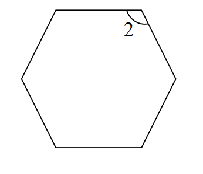
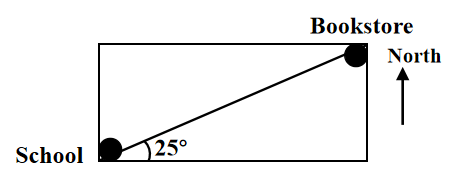

# AVP0657 — Single visual target

We-Math:239 / We-Math:404 · same type · Geometric markers

## Shared or similar visual information

A short circular arc drawn between rays near their common vertex.

## Evidence locations

- Left image: The arc beside the numeral 2 at the upper-right vertex of the hexagon.
- Right image: The arc beside the 25-degree label at the school point.

## Mathematical meanings

Left image: It identifies the interior angle labeled 2 at that vertex. Right image: It identifies the angle between the bookstore direction and the rightward horizontal side.

## Same mathematical meanings

yes

## Rationales

Each short arc is placed inside the wedge it selects. This use attaches an angle label to the relevant rays or identifies the marked vertex angle.

Only the selected target is annotated. AI visual-review draft; not independently double-annotated by humans.
